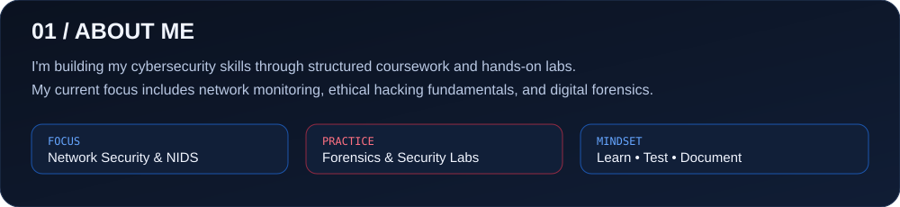

## Featured Projects

| Project | Description | Link |
|---|---|---|
| **Network Intrusion Detection System (NIDS)** | Practical network monitoring and intrusion detection using Snort 3. | [View NIDS Project](https://github.com/abhijeet0911/codealpha_tasks) |
| **Phishing Awareness Training** | Cybersecurity awareness presentation and phishing education. | [View Project](https://github.com/abhijeet0911/codealpha_tasks) |
| **CodeAlpha Internship** | My cybersecurity internship project repository. | [View Repository](https://github.com/abhijeet0911/codealpha_tasks) |

## Tools I Practise With

`Kali Linux` · `Snort 3` · `Wireshark` · `Autopsy` · `FTK Imager` · `Nmap` · `Git` · `Linux`

---

*Learning cybersecurity by building, testing, documenting, and improving.*

